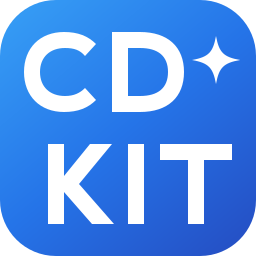
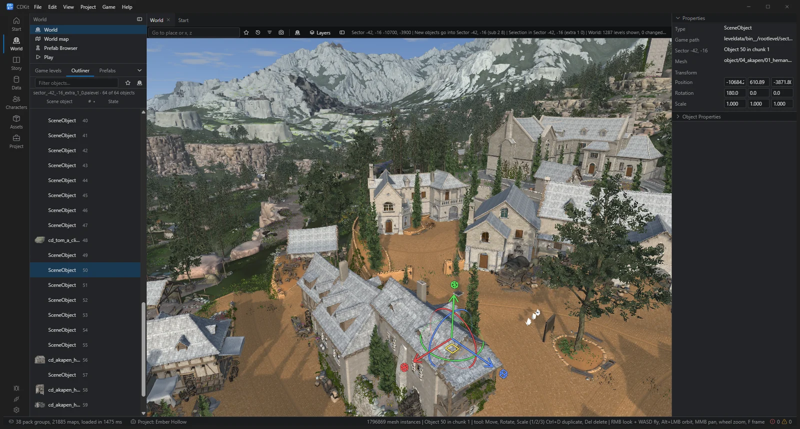

<h1 align="center">CDKit</h1>

<b>The modding toolkit for Crimson Desert</b> 
Edit the world, sculpt terrain, write quests, add characters – and play it all in the game.

  <a href="https://moon-yungg.github.io/CDKit-Releases/">Website</a> ·
  <a href="https://github.com/Moon-yungg/CDKit-Releases/releases/latest">Download</a> ·
  <a href="https://github.com/Moon-yungg/CDKit-Releases/wiki">Guide</a> ·
  <a href="https://discord.gg/HfkShRJZU">Discord</a>

## Get started

1. Download `CDKit.zip` from the [latest release](https://github.com/Moon-yungg/CDKit-Releases/releases/latest).
2. Unpack it into a folder of your own (not the game folder, not `Program Files`).
3. Start `CDkit.exe` and follow the [getting started guide](https://github.com/Moon-yungg/CDKit-Releases/wiki/Getting-Started).

CDKit updates itself (the Nexus Mods edition does not go online). **No original game file is changed:** the small
runtime `cdkit.asi` (loaded by an ASI loader such as Ultimate ASI Loader in `bin64`, not included) builds your enabled
mods together when the game starts – with a loading screen – and shows them to the game. Several mods load together in
your own order; where two of them change the same thing, CDKit lists the conflict and who wins. Switch a mod off in the
mod manager and the next start uses the game's own files again.

**Playing mods without CDKit:** download `CDKit-Runtime-<version>.zip` from the release, unzip it into the game folder
and put the mods (`.cdpkg`) into `bin64\CDKit\mods` – see the guide's page "Playing CDKit mods".

---

CDKit is a free, fan-made modding tool, not affiliated with or endorsed by Pearl Abyss. Crimson Desert is a
trademark of its respective owner.
